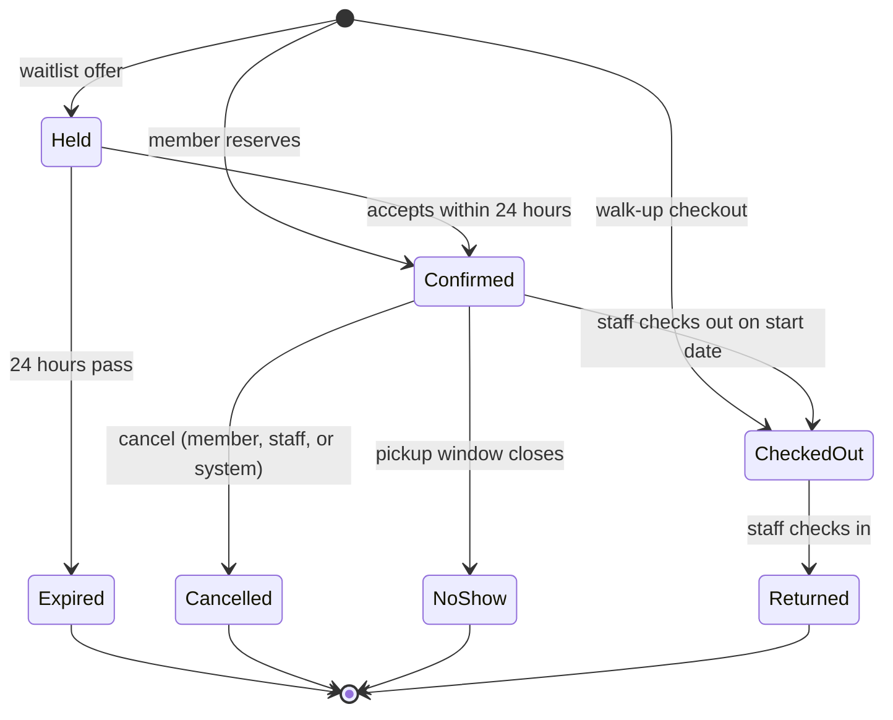

# GearShare: Project Specification

I wrote this spec before writing any code, to treat GearShare like a real product with real requirements rather than a tutorial. It covers requirements, user stories, edge cases, data model, endpoints, and milestones, and it's the source of truth for every issue in this repo. Written October 16, 2026.

## Contents

- [Overview](#overview)
- [Tech requirements and principles](#tech-requirements-and-principles)
- [User roles](#user-roles)
- [User stories](#user-stories)
- [Functional requirements](#functional-requirements)
- [Business rules and default settings](#business-rules-and-default-settings)
- [Edge cases](#edge-cases)
- [Non-functional requirements](#non-functional-requirements)
- [Minimum data model](#minimum-data-model)
- [Required API endpoints](#required-api-endpoints)
- [Milestones](#milestones)
- [Quality bar](#quality-bar)
- [Future work](#future-work)
- [Tech stack and packages](#tech-stack-and-packages)
- [Sources](#sources)

## Overview

**GearShare** is a C# web API backed by a relational database that lets a club, makerspace, or office lend out equipment like cameras, tools, and camping gear. Members reserve items for date ranges, staff check items out and back in, and the system tracks condition, maintenance, late fees, and a waitlist.

I chose this domain on purpose. The create/read/update/delete part is simple, so the real work is in the rules: no double bookings, two people hitting "reserve" at the same moment, status changes that must happen in the right order, and money math that has to be exact.

What this project is built to show:

- Relational data modeling, migrations, indexes, and constraints
- Transactions and concurrency control
- REST API design with consistent error responses
- Authentication and role-based authorization
- Input validation and business rule enforcement
- Scheduled background jobs
- Unit tests plus integration tests against a real database
- Structured logging and a clean, layered project layout

## Tech requirements and principles

GearShare targets .NET 10 with C# 14, the current Long Term Support release, supported until November 10, 2028 ([source](https://aspnetzero.com/blog/what-.net-10-lts-means-for-enterprise-applications)).

| Area | Requirement |
| --- | --- |
| Runtime | .NET 10 SDK, C# 14 |
| API | ASP.NET Core Web API with controllers |
| Database | PostgreSQL |
| Data access | EF Core with code-first migrations. Raw SQL or Dapper allowed for reports. |
| Tests | Unit tests plus integration tests that run against the same database engine used in production |
| Source control | Git, at least one tagged commit per milestone, and a README |
| Local setup | Database runs from a docker compose file, so a fresh clone works in a few commands |

Principles:

- Business rules live in a service or domain layer, not in controllers.
- Never trust the client. Every rule in this spec is enforced on the server.
- When this spec leaves a choice open, the decision and the reason go in [DECISIONS.md](../DECISIONS.md).
- The database backs up the code. Rules like "no overlapping reservations" are enforced by constraints, not just by checks in C#.

## User roles

GearShare has three roles, and each one can do everything the role before it can.

| Role | Who it is | What they can do |
| --- | --- | --- |
| Member | Anyone who registers | Browse the catalog, reserve items, change or cancel their own reservations, join waitlists, see their own history and fees |
| Staff | Front desk workers | Check items out and in, record condition, open and close maintenance, charge, record payments and waive fees, see all reservations |
| Admin | Owner of the system | Manage items, categories, users, roles, and lending settings; run reports; read the audit log |

## User stories

There are 18 stories. Each one maps to the functional requirement group that makes it work.

| ID | Role | Story | Covered by |
| --- | --- | --- | --- |
| US-01 | Member | I want to register and log in so that I can reserve gear under my own account. | FR-1 |
| US-02 | Member | I want to search by keyword, category, and the dates I need so that I only see items I can actually get. | FR-2 |
| US-03 | Member | I want to see an item's booked dates so that I can pick a free window. | FR-2 |
| US-04 | Member | I want to reserve an item for a date range so that it is held for me. | FR-3 |
| US-05 | Member | I want to change the dates of or cancel my reservation so that my plans can change without calling anyone. | FR-3 |
| US-06 | Member | I want to join a waitlist when an item is booked so that I get it if it frees up. | FR-7 |
| US-07 | Member | I want to see my past rentals and what I owe so that there are no surprises. | FR-5 |
| US-08 | Member | I want reminders before pickup and before my due date so that I don't pay late fees. | FR-8 |
| US-09 | Staff | I want one list of today's pickups and returns so that I can prepare the desk. | FR-4 |
| US-10 | Staff | I want to check out an item against a reservation, or to a walk-up member when it is free, so that every handoff is recorded. | FR-4 |
| US-11 | Staff | I want to check in an item and record its condition so that damage is caught right away. | FR-4 |
| US-12 | Staff | I want to put an item into maintenance and bring it back so that broken gear can't be booked. | FR-6 |
| US-13 | Staff | I want to charge, record a payment for, or waive a fee with a reason so that balances stay accurate. | FR-5 |
| US-14 | Admin | I want to add, edit, and retire items and categories so that the catalog matches the shelf. | FR-2 |
| US-15 | Admin | I want to change user roles and suspend accounts so that I control who can do what. | FR-1 |
| US-16 | Admin | I want to change lending settings without a code change so that policy can evolve. | FR-9 |
| US-17 | Admin | I want usage, overdue, and fee reports with CSV export so that I can make buying decisions. | FR-10 |
| US-18 | Admin | I want to see who changed what and when so that I can settle disputes. | FR-11 |

## Functional requirements

These are the testable "the system shall" rules, grouped into 11 areas. Default numbers come from the [Business rules](#business-rules-and-default-settings) section and must be configurable.

### FR-1 Accounts and access

- **FR-1.1** Register with email, display name, and password. Email is trimmed and unique without regard to case.
- **FR-1.2** Passwords are stored as salted, slow hashes. Never stored or logged in plain text.
- **FR-1.3** Login returns a token or auth cookie that expires after 60 minutes.
- **FR-1.4** Every endpoint checks the caller's role. Not logged in returns 401. Wrong role returns 403.
- **FR-1.5** Admins can change roles and suspend or reactivate accounts. Suspending needs a reason.
- **FR-1.6** Suspended users can log in and view their own data, but cannot reserve, join waitlists, or check out.
- **FR-1.7** After 5 failed logins in a row, the account is locked for 15 minutes.

### FR-2 Catalog

- **FR-2.1** An item has a name, description, category, unique asset tag, condition, status, replacement cost, and an optional daily late fee override.
- **FR-2.2** Item status describes where the item physically is: Available, CheckedOut, InMaintenance, or Retired. Reservations do not change item status.
- **FR-2.3** Search by keyword, category, and an optional date window. With a window, only items free for every day in it are returned.
- **FR-2.4** Results are paged. Default page size 20, max 100. Sort by name or by checkout count.
- **FR-2.5** Item detail shows booked date ranges for the next 60 days. Members do not see who booked them.
- **FR-2.6** Retiring is a soft delete. Retired items keep their history and are hidden from member search.
- **FR-2.7** Category names are unique. A category that still has items cannot be deleted.

### FR-3 Reservations

- **FR-3.1** A member reserves one item for a start date and end date. Dates are whole days, both inclusive, in the business time zone.
- **FR-3.2** Reservations in Held, Confirmed, or CheckedOut status "block" their dates. Two blocking reservations for the same item can never overlap, and the database itself must enforce this.
- **FR-3.3** Every new or changed reservation must pass all business rules: max length, max advance booking, max active reservations, fee balance block, and not suspended.
- **FR-3.4** A member can change the dates of a Confirmed reservation. The new range must pass every rule, and the change either fully succeeds or changes nothing.
- **FR-3.5** A member can cancel their Confirmed reservation any time before checkout. Staff can cancel any Confirmed reservation with a reason.
- **FR-3.6** A Confirmed reservation not picked up by the end of the pickup window on its start date becomes NoShow, and its dates are freed.
- **FR-3.7** Reservations follow the lifecycle below. Any other status change is rejected with 409 Conflict.

#### Reservation lifecycle

Only **Held**, **Confirmed**, and **CheckedOut** block their dates. All other statuses are final.

| From | To | Trigger |
| --- | --- | --- |
| (new) | Held | Waitlist offer |
| (new) | Confirmed | Member reserves |
| (new) | CheckedOut | Walk-up checkout |
| Held | Confirmed | Member accepts within 24 hours |
| Held | Expired | 24 hours pass; next in line gets an offer |
| Confirmed | CheckedOut | Staff checks out on the start date |
| Confirmed | Cancelled | Cancelled by member, staff, or system |
| Confirmed | NoShow | Pickup window closes |
| CheckedOut | Returned | Staff checks in |

Any status change not listed here is rejected with 409 Conflict.

### FR-4 Checkout and return

- **FR-4.1** Staff check out a Confirmed reservation on its start date, before the pickup window closes.
- **FR-4.2** Checkout records the staff user, the time, the condition going out, and the daily late fee rate in effect. Item status becomes CheckedOut.
- **FR-4.3** Walk-up checkout creates a reservation that starts today and goes straight to CheckedOut. All normal reservation rules still apply.
- **FR-4.4** Check-in records the time, the condition coming back, and notes. Item status returns to Available, or becomes InMaintenance if the condition is Damaged.
- **FR-4.5** A late return creates a late fee charge automatically (FR-5.2).
- **FR-4.6** A staff desk endpoint lists today's pickups, today's returns, and everything overdue.

### FR-5 Fees

- **FR-5.1** Fees are a ledger. Every charge, payment, and waiver is its own row. A balance is the sum of rows, never a stored number that gets edited.
- **FR-5.2** Late fee = late days times the daily rate saved at checkout, capped at the item's replacement cost.
- **FR-5.3** Staff can add a damage charge with a description.
- **FR-5.4** Staff record payments. There is no real payment processing. A payment cannot be more than the current balance.
- **FR-5.5** A waiver needs a reason and cannot be more than the unwaived amount of the charge it targets.
- **FR-5.6** A member whose balance is at or above the block threshold cannot reserve or check out.
- **FR-5.7** Members can see their own ledger and balance.

### FR-6 Maintenance

- **FR-6.1** Staff open a maintenance record with a reason. Item status becomes InMaintenance. A checked-out item must be checked in first.
- **FR-6.2** Closing the record with notes sets the item back to Available.
- **FR-6.3** When maintenance opens, Confirmed reservations for that item are flagged as at risk and those members are notified.
- **FR-6.4** If maintenance is still open on an at-risk reservation's start date, the system cancels it and notifies the member.

### FR-7 Waitlist

- **FR-7.1** A member can join the waitlist for an item and date range that is currently blocked, and can leave it any time.
- **FR-7.2** The waitlist for each item is first come, first served.
- **FR-7.3** When dates free up (cancel, date change, NoShow, early return), the system finds the earliest entry whose whole range is now free and whose member is still eligible. It creates a Held reservation for that member.
- **FR-7.4** The member has 24 hours to accept the hold, which makes it Confirmed. Otherwise it becomes Expired and the next eligible entry gets an offer.

### FR-8 Notifications and background jobs

- **FR-8.1** Notifications are written to an outbox table in the same transaction as the change that caused them.
- **FR-8.2** A background worker "sends" pending notifications (to the log or a fake email sender), marks them sent, and retries a failure up to 3 times.
- **FR-8.3** Notification triggers: reservation confirmed, pickup reminder the day before, due reminder the day before, overdue (at most once per day), waitlist offer, reservation at risk or cancelled by the system, fee charged.
- **FR-8.4** A scheduled job runs every 15 minutes to mark NoShows, expire holds, cancel at-risk reservations, and queue reminders.
- **FR-8.5** Jobs are idempotent. Running a job twice in a row never double-sends, double-charges, or double-cancels.

### FR-9 Settings

- **FR-9.1** Lending rules are stored in the database. Admins can read and change them through the API.
- **FR-9.2** Changes apply to new actions only. Existing reservations are not cancelled or repriced by a rule change.

### FR-10 Reports (Admin)

- **FR-10.1** Overdue list: item, member, due date, days late, fee so far.
- **FR-10.2** Utilization per item for a date range: percent of days the item was reserved or out.
- **FR-10.3** Top 10 items by checkout count for a date range.
- **FR-10.4** Fees charged, paid, and waived, totaled by month.
- **FR-10.5** Every report can be downloaded as CSV.

### FR-11 Audit log

- **FR-11.1** Every change to items, reservations, fees, users, roles, and settings writes an audit record: who, when (UTC), entity type, entity ID, action, old values, new values.
- **FR-11.2** Audit records are append-only. No endpoint can edit or delete them.
- **FR-11.3** Admins can filter the audit log by entity, user, and date range.

## Business rules and default settings

These defaults are seeded into the settings table and drive every rule check. Tests read them from settings rather than hard-coding them.

| Setting | Default | Notes |
| --- | --- | --- |
| Business time zone | `America/New_York` | Every "day" is counted in this zone. All timestamps are stored in UTC. |
| Max reservation length | 7 days | Inclusive. 7 days is allowed, 8 is rejected. |
| Max advance booking | 60 days | Start date can be at most 60 days after today. |
| Max active reservations per member | 3 | Held, Confirmed, and CheckedOut all count. |
| Pickup window closes | 6:00 PM on the start date | After this, a Confirmed reservation becomes NoShow. |
| Waitlist hold time | 24 hours | From the moment the hold is created. |
| Default late fee | $2.00 per day | An item can override this. |
| Late fee cap | Item replacement cost | Per reservation. |
| Fee block threshold | $25.00 | Blocked when balance is at or above this. |
| Login lockout | 5 failures, 15 minutes | |
| Token lifetime | 60 minutes | |
| Money rounding | 2 decimal places, midpoint away from zero | Use `decimal`, never `double`. |

**How late days are counted:** returning any time on the end date is on time. Each calendar day after the end date, in the business time zone, adds one late day. Returning at 12:05 AM the next day is 1 late day.

## Edge cases

Every one of these 41 cases needs at least one automated test. Status codes: 400 for bad input or a broken rule, 401 not logged in, 403 wrong role, 404 not found, 409 conflict with current state.

### Dates and time

| ID | Scenario | Expected result |
| --- | --- | --- |
| EC-01 | End date is before start date | 400 |
| EC-02 | Start date is yesterday, or today after the pickup window closed | 400 |
| EC-03 | Existing reservation ends Oct 10, new one starts Oct 10 | Rejected as overlap. Starting Oct 11 is allowed. |
| EC-04 | Reservation is exactly 7 days, or starts exactly 60 days out | Allowed. 8 days or 61 days out is rejected. |
| EC-05 | Reservation spans the daylight saving change (Nov 1 to Nov 7, 2026) | Still counts as 7 days. Late fee math is unchanged. |
| EC-06 | Returned 11:59 PM Eastern on the end date (03:59 UTC the next day) | On time. 12:05 AM Eastern the next day is 1 late day. |
| EC-07 | Tests that depend on "today" or "now" | Use an injected clock, never `DateTime.Now`, so tests can pin any date, including Feb 29, 2028. |

### Concurrency

| ID | Scenario | Expected result |
| --- | --- | --- |
| EC-08 | Two members reserve the same item for overlapping dates at the same instant | Exactly one succeeds. The other gets 409. Prove it with parallel requests in a test. |
| EC-09 | Two staff edit the same item at the same time | The second save gets 409 (optimistic concurrency token). |
| EC-10 | A member cancels while staff check out the same reservation | One wins. The other gets 409 with the current status. |
| EC-11 | Two app instances run the scheduled job at the same moment | Each NoShow, hold expiry, and reminder happens exactly once. |
| EC-12 | Member with 2 active reservations sends 2 reserve requests at once | Only one succeeds. The limit of 3 is never exceeded. |

### Status changes

| ID | Scenario | Expected result |
| --- | --- | --- |
| EC-13 | Check out a Cancelled, NoShow, or Expired reservation | 409 |
| EC-14 | Check in an item that is not checked out | 409 |
| EC-15 | Retire an item that is checked out, or that has future Confirmed reservations | 409. With `force=true`, future reservations are cancelled and members notified. A checked-out item can never be retired. |
| EC-16 | Item comes back Damaged and the next reservation starts tomorrow | Item goes to maintenance. Next reservation is flagged at risk and the member is notified. |
| EC-17 | Item is returned late and the next member's start date has arrived | Staff desk flags it. If the item is not back when the pickup window closes, the next reservation is cancelled with reason "item not returned", not marked NoShow. |
| EC-18 | Member changes dates on a CheckedOut reservation | 409. Extensions are a stretch goal. |
| EC-19 | Member accepts a hold that already expired | 409 |

### Users and access

| ID | Scenario | Expected result |
| --- | --- | --- |
| EC-20 | Member requests another member's reservation by ID | 404, so IDs do not leak |
| EC-21 | Register "Taylor@Example.com " when "taylor@example.com" exists | 409 duplicate |
| EC-22 | The only admin removes their own admin role or suspends themselves | 409. There must always be at least one active admin. |
| EC-23 | Member is suspended while holding Confirmed reservations and waitlist entries | Confirmed reservations are cancelled, waitlist entries removed, member notified. Checked-out items still must come back. |
| EC-24 | Expired or tampered token | 401 |
| EC-25 | Admin wants to delete a user with history | Not allowed. Users are deactivated, never hard-deleted, so reports and audit stay intact. |

### Money

| ID | Scenario | Expected result |
| --- | --- | --- |
| EC-26 | Late fee would exceed the item's replacement cost | Capped at replacement cost |
| EC-27 | Waiver bigger than what is left of the charge, or payment bigger than the balance | 400 |
| EC-28 | Balance is exactly $25.00 | Blocked. $24.99 is allowed. |
| EC-29 | Admin changes the late fee rate while an item is out | The fee uses the rate saved at checkout. |
| EC-30 | Admin sets a late fee of $1.555 | 400. Money values have at most 2 decimal places. |

### Waitlist

| ID | Scenario | Expected result |
| --- | --- | --- |
| EC-31 | First person in line is now suspended, at the active limit, or over the fee threshold | Skipped for this offer. The next eligible entry gets it. |
| EC-32 | Member joins a waitlist for dates they already have reserved | 400 |
| EC-33 | Same member joins the same item's waitlist twice for overlapping dates | 409 |
| EC-34 | Freed dates only cover part of an entry's range | No offer for that entry. Check the next one. |
| EC-35 | A hold expires and no remaining entry fits the dates | Dates stay free. No offer is made. |

### Input and paging

| ID | Scenario | Expected result |
| --- | --- | --- |
| EC-36 | Name is empty, only spaces, or 10,000 characters | 400 with a message for that field |
| EC-37 | Search text contains `%`, `_`, quotes, or `'; DROP TABLE items;--` | Treated as plain text. Queries are parameterized and LIKE wildcards are escaped. |
| EC-38 | Page number past the last page; page size 0 or 500 | Past the end returns 200 with an empty list. Bad page size returns 400. |
| EC-39 | Duplicate asset tag with different capitalization | 409 |
| EC-40 | Malformed ID in the URL; well-formed ID that does not exist | 400; 404 |
| EC-41 | Item named "Café 📷 Kit" | Saves, displays, and is found by search for "cafe" or "café". Record which in DECISIONS.md. |

## Non-functional requirements

These cover how well the system is built, and each one has a concrete way to verify it.

| ID | Requirement | How it's verified |
| --- | --- | --- |
| NFR-1 | Separate projects for API, application/domain logic, and data access. Endpoints hold no business rules. | Folder layout plus a quick code read |
| NFR-2 | Money is stored as `numeric(10,2)` (or `decimal(10,2)`) and handled as C# `decimal` | Schema and code |
| NFR-3 | Timestamps are stored in UTC. Reservation dates are stored as a date type with no time. | Schema plus EC-05 and EC-06 tests |
| NFR-4 | All errors use the ProblemDetails format with a trace ID | One integration test per status code checks the shape |
| NFR-5 | Structured logs carry a request ID. Passwords and tokens never appear in logs. | Read the logs from a test run |
| NFR-6 | Search answers in under 300 ms (95th percentile) with 10,000 items and 100,000 reservations seeded | Seed script, timing results, and the indexes added |
| NFR-7 | Integration tests run against a real database in a container, not EF's in-memory provider | Test project setup |
| NFR-8 | Test names reference the FR or EC IDs they cover | Search the test project for each ID |
| NFR-9 | An OpenAPI document is generated and browsable in development | Open it in the browser |
| NFR-10 | Secrets (signing key, connection string) come from user secrets or environment variables, never Git | Search the repo history |
| NFR-11 | Migrations apply cleanly to an empty database and are the only way the schema changes | Drop the database and run them |
| NFR-12 | A fresh clone runs in 5 commands or fewer, as written in the README | Try it in a new folder |

## Minimum data model

The schema has at least these 10 tables. Exact column names and types are settled during implementation.

| Entity | Must store | Constraints the database enforces |
| --- | --- | --- |
| User | Email, display name, role, status (Active, Suspended, Deactivated), suspension reason | Unique normalized email |
| Category | Name | Unique name |
| Item | Fields from FR-2.1, a concurrency token | Unique asset tag (any case), foreign key to category, replacement cost above 0 |
| Reservation | Item, member, start and end date, status, at-risk flag, cancel reason, hold expiry, checkout and return details, rate saved at checkout, a concurrency token | End date on or after start date; no two blocking reservations for one item overlap |
| WaitlistEntry | Item, member, date range, joined time, status | One member cannot have overlapping waiting entries for the same item |
| MaintenanceRecord | Item, opened by and when, reason, closed by and when, notes | At most one open record per item |
| FeeTransaction | Member, optional reservation, type (LateFee, Damage, Payment, Waiver), amount, related charge for waivers, reason, who and when | Amount above 0 |
| Notification | Recipient, type, content, created time, sent time, attempt count, dedupe key | Unique dedupe key, so a job that runs twice cannot double-send |
| Setting | Key, value, who changed it and when | Unique key |
| AuditLog | Who, when, entity type and ID, action, old and new values as JSON | No updates or deletes allowed |

**Implementation notes:** the overlap rule uses a PostgreSQL exclusion constraint on a `daterange`, and "one open record per item" uses a partial unique index.

## Required API endpoints

These 32 routes are the minimum. Any route that changes from this list is noted in DECISIONS.md.

| Method | Route | Who | Covers |
| --- | --- | --- | --- |
| POST | `/api/auth/register` | Public | FR-1.1 |
| POST | `/api/auth/login` | Public | FR-1.3, FR-1.7 |
| GET | `/api/me` | Any user | FR-1.6 |
| GET | `/api/items?q=&categoryId=&from=&to=&page=&pageSize=&sort=` | Any user | FR-2.3, FR-2.4 |
| GET | `/api/items/{id}` | Any user | FR-2.5 |
| POST | `/api/items` | Admin | FR-2.1 |
| PUT | `/api/items/{id}` | Admin | FR-2.1 |
| POST | `/api/items/{id}/retire` | Admin | FR-2.6 |
| GET, POST, PUT, DELETE | `/api/categories` | GET any user, others Admin | FR-2.7 |
| POST | `/api/reservations` | Member | FR-3.1 to FR-3.3 |
| GET | `/api/reservations/mine` | Member | FR-3 |
| PATCH | `/api/reservations/{id}` | Owner | FR-3.4 |
| POST | `/api/reservations/{id}/cancel` | Owner or Staff | FR-3.5 |
| POST | `/api/reservations/{id}/accept-hold` | Owner | FR-7.4 |
| POST | `/api/reservations/{id}/checkout` | Staff | FR-4.1, FR-4.2 |
| POST | `/api/reservations/{id}/return` | Staff | FR-4.4, FR-4.5 |
| POST | `/api/checkouts/walk-up` | Staff | FR-4.3 |
| GET | `/api/desk/today` | Staff | FR-4.6 |
| POST | `/api/items/{id}/waitlist` | Member | FR-7.1 |
| DELETE | `/api/waitlist/{entryId}` | Owner | FR-7.1 |
| POST | `/api/items/{id}/maintenance` | Staff | FR-6.1, FR-6.3 |
| POST | `/api/maintenance/{id}/close` | Staff | FR-6.2 |
| GET | `/api/me/ledger` | Member | FR-5.7 |
| POST | `/api/users/{id}/charges` | Staff | FR-5.3 |
| POST | `/api/users/{id}/payments` | Staff | FR-5.4 |
| POST | `/api/charges/{id}/waive` | Staff | FR-5.5 |
| GET | `/api/users` | Admin | FR-1.5 |
| PUT | `/api/users/{id}/role` | Admin | FR-1.5 |
| POST | `/api/users/{id}/suspend` and `/reactivate` | Admin | FR-1.5, FR-1.6 |
| GET, PUT | `/api/settings` | Admin | FR-9 |
| GET | `/api/reports/{overdue, utilization, top-items, fees}?format=csv` | Admin | FR-10 |
| GET | `/api/audit?entityType=&entityId=&userId=&from=&to=` | Admin | FR-11.3 |

## Milestones

GearShare is built in 6 milestones. Each one is finished, reviewed against this spec, and tagged in Git (`m1`, `m2`, ...) before the next one starts. Progress is tracked in the repo's GitHub milestones and issues.

1. **M1 Foundation.** Solution layout, docker compose database, EF Core migrations, Category and Item CRUD, basic search and paging, seed data, OpenAPI page, first tests.
    - Done when: a fresh clone runs, migrations build an empty database, and EC-36 to EC-41 pass.
2. **M2 Accounts and roles.** Register, login, lockout, role checks, suspend and reactivate.
    - Done when: FR-1 is complete and EC-20 to EC-25 pass.
3. **M3 Reservations.** Create, change, and cancel; database-level overlap protection; all business rule checks; injected clock; availability filter in search.
    - Done when: FR-2.3, FR-2.5, and FR-3.1 to FR-3.5 are complete, and EC-01 to EC-08 and EC-12 pass.
4. **M4 Checkout, return, fees, maintenance.** Desk endpoint, walk-ups, ledger, late fees, damage, waivers, payments.
    - Done when: FR-4, FR-5, and FR-6 are complete, and EC-09, EC-10, EC-13 to EC-18, and EC-26 to EC-30 pass.
5. **M5 Waitlist, notifications, jobs.** Outbox, worker, scheduled job, holds, NoShows.
    - Done when: FR-3.6, FR-7, and FR-8 are complete, and EC-11, EC-19, and EC-31 to EC-35 pass.
6. **M6 Settings, reports, audit, performance.** Seed 100,000 reservations, add indexes, finish the README.
    - Done when: FR-9 to FR-11 are complete and every NFR is met.

## Quality bar

Each milestone is reviewed against this rubric and scored out of 100. The target is 90 or above before moving on.

| Category | Points | What full marks look like |
| --- | --- | --- |
| Business rules | 25 | Every FR behaves as written, and rules are read from settings |
| Data integrity and concurrency | 20 | Overlap and limit rules hold under parallel requests, database constraints back up code checks, jobs are idempotent |
| Tests | 20 | All 41 edge cases covered, integration tests use a real database, no test depends on today's date |
| API design and errors | 10 | Consistent routes, correct status codes, ProblemDetails everywhere, working OpenAPI page |
| Code structure | 10 | Clear layers, small focused classes, no business logic in endpoints |
| Docs and setup | 10 | README, DECISIONS.md, one-command database, clean migrations |
| Security | 5 | Hashed passwords, role check on every route, no secrets in Git |

## Future work

Ideas planned for after M6.

- A Blazor or React front end for members and staff
- Reservation extensions for checked-out items, with the same overlap rules
- Real email to a local test inbox
- Expand CI with test coverage reports and a required status check on every pull request
- Rate limiting on login and reserve endpoints using ASP.NET Core's built-in rate limiter
- Item photo uploads with file size and type checks
- Rewrite one report with raw SQL and compare timing and query plans against the EF Core version
- Offer an equivalent item when a reserved item goes into maintenance
- Package the API as a container image and deploy it to a Linux server
- Health check endpoints and OpenTelemetry tracing

## Tech stack and packages

The core stack is ASP.NET Core 10, EF Core 10, and PostgreSQL through Npgsql. Each package below was picked to solve a specific requirement in this spec.

### Building the app

| Package | Used for | Milestone |
| --- | --- | --- |
| Microsoft.EntityFrameworkCore, Microsoft.EntityFrameworkCore.Design, `dotnet-ef` tool | ORM and migrations | M1 |
| Npgsql.EntityFrameworkCore.PostgreSQL | PostgreSQL provider. Supports range types, which the overlap constraint needs. | M1 |
| Microsoft.AspNetCore.OpenApi | Generates the OpenAPI document. It replaced Swashbuckle in the templates in .NET 9, and .NET 10 outputs OpenAPI 3.1 ([source](https://scalar.com/blog/posts/2026-10-06-openapi-aspnet-core-dotnet-9-10)). | M1 |
| Scalar.AspNetCore | A browsable API page on top of that document, since the built-in package ships no UI | M1 |
| FluentValidation plus FluentValidation.DependencyInjectionExtensions | Request validation with clear per-field messages | M1 |
| Serilog.AspNetCore | Structured logging with request IDs | M1 |
| Microsoft.AspNetCore.Identity.EntityFrameworkCore | User storage, password hashing, login lockout | M2 |
| Microsoft.AspNetCore.Authentication.JwtBearer | Token authentication | M2 |
| Built-in `TimeProvider` plus Microsoft.Extensions.TimeProvider.Testing | An injectable clock. `FakeTimeProvider` lets tests set "now" to any moment. | M3 |
| NodaTime (if needed) | Stronger date and time zone types. Npgsql has a NodaTime plugin. | M3 |
| Built-in `BackgroundService` or Quartz.NET (to be decided) | Scheduled jobs. Quartz can run clustered, which helps with EC-11. | M5 |
| Dapper | Hand-written SQL for reports | M6 |
| CsvHelper | CSV export | M6 |

### Testing

| Package | Used for | Milestone |
| --- | --- | --- |
| xunit.v3 | Test framework | M1 |
| Microsoft.AspNetCore.Mvc.Testing | `WebApplicationFactory` runs the whole API in memory for integration tests | M1 |
| Testcontainers.PostgreSql | Starts a real PostgreSQL in Docker for the test run | M1 |
| Respawn | Wipes test data between tests quickly | M1 |
| Shouldly | Readable assertions | M1 |
| NSubstitute | Fakes for unit tests | M3 |
| Bogus | Realistic fake data for seeding 100,000 rows | M6 |
| NetArchTest.Rules | Tests that enforce the layer rules (NFR-1) | M6 |

**Not using AutoMapper or MediatR.** Since July 2025, their new major versions (AutoMapper 15+, MediatR 13+) use a dual commercial license ([source](https://www.jimmybogard.com/automapper-and-mediatr-commercial-editions-launch-today/)). Mapping and request handling are written by hand instead, which keeps the code explicit and easy to follow.

**Tools:** Visual Studio 2026, Docker Desktop, DBeaver for inspecting the database, and `.http` files for manual API calls.

## Sources

- [What .NET 10 LTS Means for Enterprise Applications](https://aspnetzero.com/blog/what-.net-10-lts-means-for-enterprise-applications), ASP.NET Zero, January 2026
- [OpenAPI with ASP.NET Core in .NET 9 and 10](https://scalar.com/blog/posts/2026-10-06-openapi-aspnet-core-dotnet-9-10), Scalar, October 2026
- [AutoMapper and MediatR Commercial Editions Launch Today](https://www.jimmybogard.com/automapper-and-mediatr-commercial-editions-launch-today/), Jimmy Bogard, July 2025
